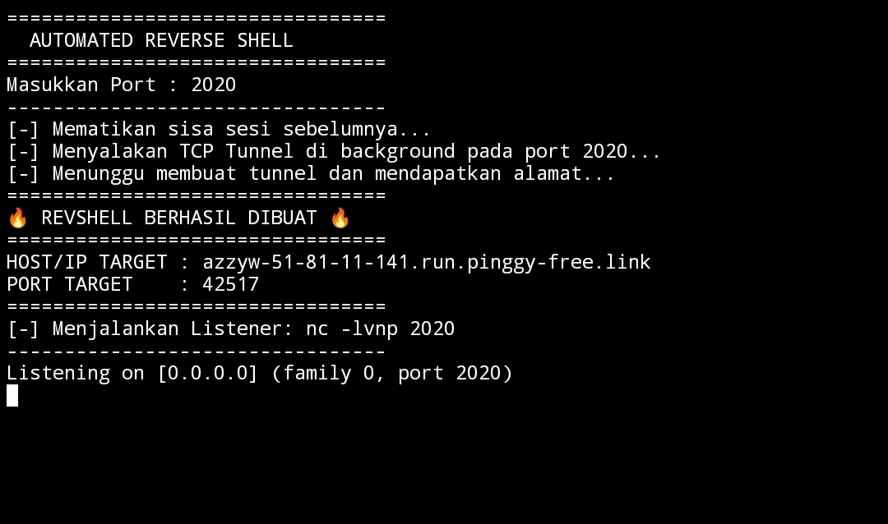

# 🚀 Auto Reverse Shell with Pinggy

Alat otomatisasi ringan untuk membuat koneksi *reverse shell* secara instan menggunakan **Pinggy** sebagai alternatif gratis untuk Ngrok. Dirancang untuk pengujian penetrasi (*penetration testing*), audit keamanan internal, dan pembelajaran secara aman.



---

## ✨ Keunggulan Tools Ini

*   💸 **100% Gratis:** Memanfaatkan layanan Pinggy tanpa memerlukan kartu kredit atau biaya langganan berbayar.
*   🚀 **Instan & Otomatis:** Memangkas langkah manual yang rumit; cukup jalankan satu perintah untuk langsung menginisialisasi terowongan (*tunnel*).
*   🌐 **Alternatif Ngrok Terbaik:** Tidak memerlukan instalasi *binary* yang berat atau registrasi akun yang rumit untuk mendapatkan tautan publik.
*   🔒 **Mendukung TLS/TCP:** Dapat dikonfigurasi dengan mudah untuk berbagai jenis protokol koneksi sesuai kebutuhan pengujian Anda.
*   🛠️ **Ringan & Portabel:** Dibangun dengan skrip yang bersih sehingga mudah dipahami, dimodifikasi, atau diintegrasikan ke dalam skrip lain.

---

## 📋 Prasyarat

Sebelum menggunakan tools ini, pastikan sistem Anda telah terinstal:
*   Bash / Zsh Shell
*   `curl` & `netcat` (nc)
*   SSH Client (untuk koneksi terowongan Pinggy)

---

## ⚙️ Cara Penggunaan

1. **Clone repository ini:**
   ```bash
   $ git clone https://github.com/T-XpLoiT/RevShell/
   $ cd RevShell
   $ bash setup.sh
2. **Jalankan Dengan**
   ```bash
   $ ./gas
